<a href="https://unlv-museum.recanon.com" target="_blank" rel="noopener">
  <picture>
    <source media="(prefers-color-scheme: dark)" srcset=".github/readme/museum-card-dark.svg">
    
  </picture>
</a>

# UNLV Museum

A living museum of the projects I built during UNLV's software development bootcamp, open at **[unlv-museum.recanon.com](https://unlv-museum.recanon.com)**.

Every exhibit sits on a vertex of an interactive icosphere. Click a dot and the sphere swings it into place, a beam rises, and a glass card unfolds with the project's name, date and summary. Click the card to step inside. Prefer a plain index? The landing page also has a list view, sortable by category or by time.

## Three tiers per project

Each project can be seen in up to three forms, toggled in place on its page:

| Tier           | What it is                                                                                                                                                                                 | Where it lives                                                                                                                            |
| -------------- | ------------------------------------------------------------------------------------------------------------------------------------------------------------------------------------------ | ----------------------------------------------------------------------------------------------------------------------------------------- |
| **Original**   | The coursework as it was turned in. Source changes are limited to what hosting it today requires: dead URLs, iframe sandboxing, a current Node LTS, pnpm. Nothing is modernized or tidied. | The source repo's `museum-ready/original` branch, pinned here as a submodule under `.sources/` and built into `public/originals/<slug>/`. |
| **Enhanced**   | The same idea on the same footing, with what the era couldn't do added on. Apps that write data, for example, gain sign-in and an audit log.                                               | Native in this repo, built on the museum's own components.                                                                                |
| **Reimagined** | A from-scratch rebuild where the stack can change entirely.                                                                                                                                | Its own repo and deployment, linked from the museum.                                                                                      |

Tiers that haven't been built yet say so. The originals are the point; the other two are added one project at a time, deliberately.

A converted original's source repo opens on its `museum-ready/original` branch, with a banner linking back to the museum and to the exact diff from the untouched `original` branch, so you can audit what hosting changed.

## How it's built

- **Next.js 16** (App Router) with **React 19** view transitions between pages. Styling is CSS modules and the museum's own design tokens.
- **The globe** is an SVG icosphere rotated by a quaternion and painted back-to-front each frame. The card-opening sequence is a small state machine (swing, beam, unfold, hold, collapse).
- **Neon Postgres + Drizzle**, one schema per project, for the backends the museum reimplements (Express/Sequelize and MongoDB exercises among them) so the original frontends keep working against live data.
- **Better Auth with GitHub sign-in.** Anything that writes requires a signed-in visitor, is rate limited, and lands in an audit log.
- **Originals as submodules.** `pnpm sync:source <slug>` rebuilds an original from its pinned branch and records a content hash that a pre-commit check verifies, so the served build can't drift from its source unnoticed.

## Running it locally

```sh
pnpm install   # also initializes the .sources/ submodules
pnpm dev       # http://localhost:3000
```

Database- and auth-backed pages need a `.env.local` (Neon `DATABASE_URL`, Better Auth and GitHub OAuth credentials). pnpm only; npm, yarn and bun aren't supported.

| Command                           | What it does                                                                        |
| --------------------------------- | ----------------------------------------------------------------------------------- |
| `pnpm build` / `pnpm start`       | Production build and server                                                         |
| `pnpm lint`                       | ESLint                                                                              |
| `pnpm sync:source <slug>`         | Rebuild one original from its submodule and refresh its lock entry                  |
| `pnpm sync:source-meta [slug]`    | Apply the source-repo conventions (default branch, README banner, website link)     |
| `pnpm verify:locks`               | Check every built original against its recorded hash                                |
| `pnpm db:push` / `pnpm db:studio` | Drizzle schema push and studio                                                      |
| `pnpm build:readme-card`          | Regenerate this README's animated card (`.github/readme/`) from the live globe code |

## Where things are

| Path                     | Contents                                                      |
| ------------------------ | ------------------------------------------------------------- |
| `src/lib/projects.tsx`   | The project registry: every exhibit, its tiers and metadata   |
| `src/app/`               | Routes: museum pages, reimplemented project APIs, SSR ports   |
| `src/components/ui/`     | The globe, the unfolding card, page chrome                    |
| `.sources/`              | Source repos as submodules, pinned to `museum-ready/original` |
| `public/originals/`      | Built originals, served in iframes                            |
| `sync.config.ts`         | Per-project build recipes for the originals                   |
| `CONTEXT/internal_docs/` | Design notes: architecture, globe, sources, auth, and more    |
